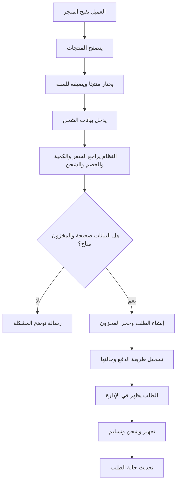

# رحلة العميل: كيف يعمل RAWAQA من البداية للنهاية؟

هذا الملف يشرح النظام كقصة تشغيلية، وليس كشرح للكود.

## 1. خريطة مبسطة للنظام

## 2. المرحلة الأولى: اكتشاف المنتج

العميل يدخل المتجر ويشاهد:
- الصفحة الرئيسية ومحتوى العلامة التجارية.
- التصنيفات والمنتجات.
- صور المنتج ووصفه وسعره.
- تفاصيل تساعده على الاختيار.

**لماذا هذه المرحلة مهمة؟**  
لأنها تقلل احتياج العميل للسؤال عن كل معلومة، وتساعده على اتخاذ قرار الشراء.

## 3. المرحلة الثانية: السلة

السلة هي قائمة مؤقتة بالمنتجات التي ينوي العميل شراءها.

تحتوي عادةً على:
- المنتج المختار.
- الكمية.
- السعر المسجل للعنصر.
- إجمالي المنتجات.

يمكن للعميل تعديل الكمية أو إزالة منتج. السلة ليست طلبًا نهائيًا؛ الطلب لا يتكون إلا عند إتمام عملية الشراء.

## 4. المرحلة الثالثة: إتمام الشراء (Checkout)

Checkout تعني الخطوة التي يحول فيها العميل محتويات السلة إلى طلب رسمي.

يدخل العميل بيانات مثل:
- اسم مستلم الطلب.
- رقم الهاتف.
- العنوان والمحافظة والمدينة.
- وسيلة الدفع.
- كود الخصم إن وجد.
- ملاحظات إضافية.

قبل إنشاء الطلب، النظام لا يثق في الإجمالي الذي يرسله المتصفح. يعيد حساب السعر والتحقق من المنتج والكمية والكوبون والشحن على الخادم.

### كيف يتكون الإجمالي؟

بشكل مبسط:

**الإجمالي = قيمة المنتجات + الشحن + الضريبة - الخصم**

القيم الفعلية وقواعد الحساب الموجودة حاليًا موضحة في ملف الحالة. القواعد الحالية في الكود تشمل:
- الشحن مجاني عند وصول قيمة المنتجات إلى 1000 جنيه أو أكثر.
- الشحن 50 جنيهًا للقاهرة والجيزة تحت الحد المجاني.
- الشحن 75 جنيهًا للمحافظات الأخرى تحت الحد المجاني.
- الضريبة محسوبة في الكود بنسبة 14% من قيمة المنتجات.

هذه أرقام من الكود الحالي وليست توصية محاسبية أو تأكيدًا بأنها السياسة التجارية المعتمدة. يجب أن يؤكدها صاحب النشاط/المحاسب، كما يجب مراجعة أساس احتساب الضريبة وما إذا كان السعر شاملًا لها قبل العرض الرسمي.

## 5. المرحلة الرابعة: إنشاء الطلب وحجز المخزون

بعد التحقق، ينشئ النظام الطلب ويحجز الكمية المطلوبة.

**ما معنى حجز المخزون؟**  
لو عندنا 5 قطع، وعميل طلب قطعتين، النظام يسجل أن قطعتين أصبحتا مخصصتين لهذا الطلب، فلا يتعامل معها كأنها متاحة لطلب جديد.

هناك فرق بين:
- **المخزون الفعلي:** عدد القطع الموجودة.
- **المخزون المحجوز:** قطع مرتبطة بطلبات لم تنتهِ بعد.
- **المتاح للبيع:** الكمية التي يمكن بيعها الآن.

يستخدم النظام تحديثًا ذريًا ومعاملة قاعدة بيانات لتقليل خطر بيع آخر قطعة لأكثر من عميل في نفس الوقت.

## 6. المرحلة الخامسة: الدفع

هناك نوعان أساسيان في تجربة البيع:
- **الدفع عند الاستلام (COD):** العميل يدفع عند وصول الطلب وفق سياسة النشاط.
- **الدفع الإلكتروني:** يتم عبر مزود دفع خارجي؛ المزود يخبر النظام بنتيجة العملية.

حالات الدفع قد تكون مثل:
- Pending: في انتظار النتيجة.
- Paid: تم الدفع.
- Failed: فشلت العملية.
- Refunded: تم رد المبلغ.

**مهم:** لا تخلط بين وجود شاشة أو كود للدفع وبين تفعيل الدفع الحقيقي. حالة Kashier الحالية موضحة في ملف [الحالة والمصطلحات](STATUS-AND-GLOSSARY.md).

## 7. المرحلة السادسة: متابعة الطلب من الإدارة

فريق التشغيل يحتاج أن يعرف:
- من صاحب الطلب؟
- ما المنتجات والكميات؟
- ما عنوان التوصيل؟
- هل الدفع مستحق أم تم؟
- ما حالة تجهيز الطلب؟
- هل تم شحنه أو تسليمه؟

حالة الطلب تصف تقدم التنفيذ، وهي مختلفة عن حالة الدفع. قد يكون الطلب قيد التجهيز بينما حالة الدفع لها قيمة منفصلة.

## 8. حالات الطلب

قد تمر الطلبات بحالات مثل:
- Pending: تم إنشاء الطلب وينتظر المراجعة.
- Confirmed: تم تأكيد الطلب.
- Processing: يتم التجهيز.
- Shipped: تم الشحن.
- Delivered: تم التسليم.
- Cancelled: تم الإلغاء.
- Refunded: تم رد المبلغ عند انطباق الحالة.

قد توجد حالات تقنية إضافية مثل انتظار الدفع أو المزامنة. لا تحفظ كل الحالات عن ظهر قلب؛ المهم أن تفهم أن الحالة تخبر فريق العمل والعميل أين وصل الطلب.

## 9. ماذا لو حدث خطأ؟

| الموقف | التصرف المتوقع |
|---|---|
| الكمية غير كافية | لا يتم تأكيد طلب بكمية غير متاحة |
| كوبون غير صالح | يرفض النظام الخصم ويعرض سببًا مناسبًا |
| بيانات ناقصة | يطلب من العميل استكمالها |
| فشل الدفع الإلكتروني | لا يتم اعتبار العملية مدفوعة |
| تكرار إرسال الطلب | تستخدم آلية تمنع إنشاء نفس العملية مرتين عند تكرار الطلب بنفس مفتاح منع التكرار |
| مستخدم يحاول مشاهدة طلب غيره | يجب منع الوصول والتحقق من الملكية |
| خدمة خارجية متوقفة | يجب ألا يؤدي فشلها تلقائيًا إلى فقدان الطلب الأساسي |

## 10. لوحة الإدارة: ماذا تعني؟

لوحة الإدارة هي مكان عمل الفريق الداخلي. يمكن تشبيهها بغرفة التحكم:
- المنتجات = ما الذي نبيعه؟
- المخزون = كم قطعة متاحة؟
- الطلبات = من اشترى وماذا طلب؟
- الكوبونات = ما العروض المسموح بها؟
- المحتوى والإعلانات = ماذا يظهر للزائر؟
- الإعدادات = كيف يتصرف الموقع؟

ليس كل موظف من المفترض أن يمتلك كل الصلاحيات. الصلاحيات تحمي بيانات العملاء وتقلل أخطاء التشغيل.

## 11. كيف ترتبط البيانات ببعضها؟

مثال:
- العميل لديه حساب.
- العميل ينشئ طلبًا.
- الطلب يحتوي على عناصر طلب.
- كل عنصر يشير إلى منتج، مع الاحتفاظ بنسخة من اسم المنتج وسعره وقت الشراء.
- الطلب يرتبط بمحاولات الدفع.
- المنتج يرتبط بالمخزون والتصنيف والصور.

لماذا نحتفظ بنسخة من الاسم والسعر داخل الطلب؟  
لأن سعر المنتج أو اسمه قد يتغير لاحقًا، لكن يجب أن يظل الطلب القديم يعرض ما اشتراه العميل وقتها.

## 12. مصطلحات لازم نفهمها

- **Frontend:** واجهة المتجر التي يراها العميل.
- **Backend:** الجزء الذي ينفذ قواعد العمل ويتعامل مع البيانات.
- **Database:** المكان المنظم لحفظ بيانات النظام.
- **API:** قناة منظمة لتبادل الطلبات والبيانات بين الواجهة والخادم.
- **Admin Dashboard:** لوحة الإدارة.
- **Checkout:** إتمام الشراء.
- **Inventory:** المخزون.
- **Webhook:** رسالة آلية يرسلها مزود خارجي للنظام عند حدوث حدث مثل نجاح الدفع.
- **Integration:** ربط النظام بخدمة أخرى.
- **Deployment:** نشر النظام على الإنترنت ليستخدمه الناس.

## 13. أسئلة للنقاش داخل الفريق

1. ما أكثر نقطة قد تسبب فقدان طلب؟
2. ما الفرق بين حالة الطلب وحالة الدفع؟
3. لماذا لا نعتمد على السعر الذي يرسله المتصفح؟
4. ما أثر بيع كمية أكبر من المخزون؟
5. ما المعلومات التي يحتاجها مسؤول الطلبات لاتخاذ قرار؟
6. ما الذي يجب أن يحدث إذا تعطلت خدمة خارجية؟
